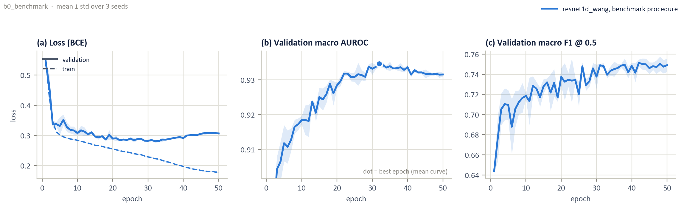
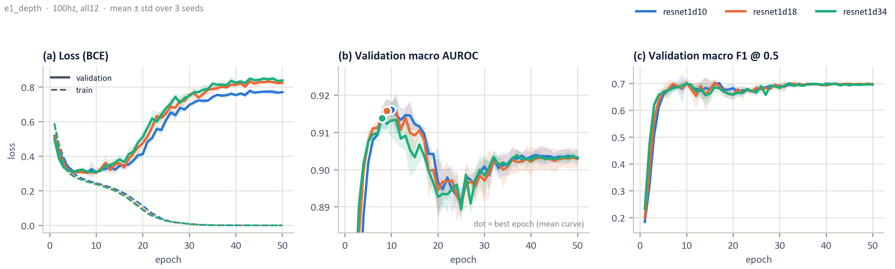
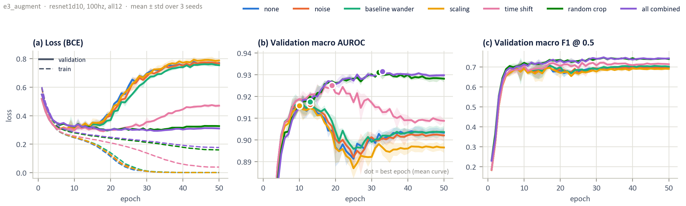

# ECG Classification

Multi-label classification of 12-lead ECGs from the [PTB-XL](https://physionet.org/content/ptb-xl/) dataset [[1, 2]](#references) into the 5 diagnostic superclasses:

| Code | Meaning |
|:----:|:--------|
| **NORM** | Normal ECG |
| **MI**   | Myocardial infarction |
| **STTC** | ST/T change |
| **CD**   | Conduction disturbance |
| **HYP**  | Hypertrophy |

Several classes can be true at once, so every model has 5 sigmoid outputs trained with binary cross-entropy.

---

## Contents

- [Research questions](#research-questions)
- [Repository structure](#repository-structure)
- [Setup](#setup)
  - [Data](#data)
  - [Exploratory data analysis](#exploratory-data-analysis)
- [Standard training protocol](#standard-training-protocol)
- [Running experiments](#running-experiments)
- [Experiments](#experiments)
  - [B0: Can we reproduce a benchmark?](#b0-can-we-reproduce-a-benchmark-resnet1d_wang)
  - [E1: Does depth help?](#e1-does-depth-help-resnet1d-10-vs-resnet1d-18-vs-resnet1d-34)
  - [E2: Which operation type fits ECG?](#e2-which-operation-type-fits-ecg-convolution-vs-bilstm-vs-cnn--transformer)
  - [E3: Which augmentations help?](#e3-which-augmentations-help-none-vs-noise-baseline-wander-scaling-time-shift-random-crop)
  - [E4: How many leads are needed?](#e4-how-many-leads-are-needed-12-leads-vs-6-limb-leads-vs-lead-ii-only)
  - [E5: Does finer resolution help?](#e5-does-finer-resolution-help-100-hz-vs-500-hz)
- [Supplementary study: Optimizing the ResNet architecture](#supplementary-study-optimizing-the-resnet-architecture)
  - [S1: Which ResNet design choices help?](#s1-which-resnet-design-choices-help-custom-resnet-variants)
  - [S2: How far can a ResNet go?](#s2-how-far-can-a-resnet-go-target-macro-auroc-094)
- [References](#references)

---

## Research questions

**Goal:** find which architecture reads ECGs best, and which choices drive its performance.

| ID | Question | Variants compared |
|:--:|:---------|:------------------|
| **B0** | [Can we reproduce a benchmark?](#b0-can-we-reproduce-a-benchmark-resnet1d_wang) | `resnet1d_wang` with the benchmark's training procedure, official split (train 1–8, val 9, test 10) |
| **E1** | [Does depth help?](#e1-does-depth-help-resnet1d-10-vs-resnet1d-18-vs-resnet1d-34) | ResNet1D-10 vs ResNet1D-18 vs ResNet1D-34 |
| **E2** | [Which operation type fits ECG?](#e2-which-operation-type-fits-ecg-convolution-vs-bilstm-vs-cnn--transformer) | Convolution vs BiLSTM vs CNN + Transformer |
| **E3** | [Which augmentations help?](#e3-which-augmentations-help-none-vs-noise-baseline-wander-scaling-time-shift-random-crop) | None, noise, baseline wander, scaling, time shift, random crop |
| **E4** | [How many leads are needed?](#e4-how-many-leads-are-needed-12-leads-vs-6-limb-leads-vs-lead-ii-only) | 12 leads vs 6 limb leads vs lead II only |
| **E5** | [Does finer resolution help?](#e5-does-finer-resolution-help-100-hz-vs-500-hz) | 100 Hz (1000 × 12) vs 500 Hz (5000 × 12) input |

**Supplementary study: Optimizing the ResNet architecture.** The ResNet received considerably more design effort than the other model families; this study is therefore reported separately from the research questions ([details](#supplementary-study-optimizing-the-resnet-architecture)).

| ID | Question | Variants compared |
|:--:|:---------|:------------------|
| **S1** | [Which ResNet design choices help?](#s1-which-resnet-design-choices-help-custom-resnet-variants) | Classic ResNet1D-10 vs custom variants (stride-1 stem, concat-pooling head, constant width), deeper classic ResNets, `resnet1d_wang` |
| **S2** | [How far can a ResNet go? (target: macro AUROC 0.94)](#s2-how-far-can-a-resnet-go-target-macro-auroc-094) | A single ResNet: architecture variants within the ResNet family, standard protocol unchanged, selected on validation |

---

## Repository structure

```text
.
├── src/
│   ├── config.py                          paths, classes, lead sets, official split, STANDARD training protocol
│   ├── data/
│   │   ├── preprocess.py                  build the signal cache (once per sampling rate)
│   │   ├── dataset.py                     label aggregation, lead selection, split, standardization
│   │   └── augment.py                     noise / baseline wander / scaling / time shift / random crop (for E3)
│   ├── models/
│   │   ├── __init__.py                    model registry
│   │   ├── bilstm.py                      bidirectional LSTM on the raw signal (E2)
│   │   ├── cnn_transformer.py             convolutional front-end + Transformer encoder (E2)
│   │   ├── heads.py                       classification heads (average pooling; concat pooling + dropout)
│   │   ├── resnet1d.py                    classic ResNet1D-10/-18/-34 and custom ResNet1D-10 variants (S1)
│   │   ├── resnet1d_plus.py               configurable ResNet for the architecture search (S2)
│   │   └── resnet1d_wang.py               resnet1d_wang of the PTB-XL benchmark (B0)
│   ├── training/
│   │   └── train.py                       training loop, logging, checkpointing (+ test evaluation at the end)
│   ├── evaluation/
│   │   ├── evaluate.py                    (re-)evaluate runs: val/test metrics, val-tuned thresholds, bootstrap CIs
│   │   ├── metrics.py                     AUROC, AUPRC, F1 (macro + per class)
│   │   └── summarize.py                   collect runs of an experiment into tables (mean ± std over seeds)
│   ├── visualize/
│   │   ├── exploratory_data_analysis.py   EDA figures + summary numbers
│   │   └── plot_runs.py                   learning curves and per-class plots for any experiment
│   └── experiments/
│       ├── b0_benchmark.py                B0: reproduction of resnet1d_wang (Strodthoff et al.)
│       ├── e1_depth.py                    E1: ResNet1D-10 vs ResNet1D-18 vs ResNet1D-34
│       ├── e2_operation.py                E2: convolution vs BiLSTM vs CNN + Transformer
│       ├── e3_augment.py                  E3: none / noise / baseline wander / scaling / time shift / random crop / all combined
│       ├── s1_resnet_design.py            S1: classic vs custom ResNet variants
│       └── s2_resnet_search.py            S2: ResNet architecture search (single model)
├── runs/<exp>/<run>/                      one folder per training run (weights not tracked)
├── eda/                                   EDA outputs
├── documentation/                         initial report (PDF) and presentation (PPTX)
└── data/                                  PTB-XL raw + processed (not tracked, see below)
```

> Each file that can be run has its usage in its docstring and `--help`.

---

## Setup

**Python 3.12.** PyTorch is installed separately because it needs the CUDA build (cu128 is required for RTX 50xx GPUs; pick another index for older GPUs or CPU).

```bash
python -m venv .venv
.venv\Scripts\activate          # Windows
# source .venv/bin/activate     # Linux / macOS
pip install torch==2.11.0 --index-url https://download.pytorch.org/whl/cu128
pip install -r requirements.txt
```

### Data

Download PTB-XL v1.0.3 [[2]](#references) from [PhysioNet](https://physionet.org/content/ptb-xl/) [[3]](#references) and extract it so that the files sit under `data/ptb-xl/` (e.g. `data/ptb-xl/ptbxl_database.csv`). Then build the cache:

```bash
python -m src.data.preprocess              # 100 Hz, ~1 GB, ~30 s
python -m src.data.preprocess --fs 500     # 500 Hz, ~5.2 GB (only needed for E5)
```

The cache stores **all** records with **all** 12 leads as raw mV (`data/processed/ptbxl_<fs>hz.npy`, shape `(21837, 12, fs*10)`, plus `labels.csv`). Everything that changes between experiments is applied at load time, so the same cache serves every experiment:

| Option | Values | Used by |
|:-------|:-------|:-------:|
| `--fs` | `100`, `500` | E5 |
| `--leads` | `all12`, `limb6`, `precordial6`, `lead1`, `lead2`, or any list like `I,II,V2` | E4 |
| `--augment` | `none` or any of `noise,wander,scale,shift,crop` | E3 |
| `--model` | `resnet1d10`, `resnet1d18`, `resnet1d34`, `resnet1d_wang`, and the S1 variants `resnet1d10_stem1`, `resnet1d10_chead`, `resnet1d10_w128`, `resnet1d10_stem1_chead_w128`, `resnet1d_plus`, `bilstm` and `cnn_transformer` (configured with `--model-kwargs`) (add new ones in `src/models/__init__.py`) | B0, E1, E2, S1, S2 |
| `--standardize` | `per_lead` (standard) or `global` (one mean/std, as in the benchmark) | B0 |

**Labels:** every diagnostic SCP statement is mapped to its superclass regardless of likelihood (as in the PhysioNet example and the Strodthoff et al. benchmark [[4]](#references)). The 407 records with no superclass label are dropped. Signals are z-scored per lead with mean/std from the training folds only.

### Exploratory data analysis

```bash
python -m src.visualize.exploratory_data_analysis
```

This writes the figures to `eda/figures/` and `eda/figures/slides/`, and the summary statistics to `eda/eda_summary.json`.

---

## Standard training protocol

All experiments use these settings (defined once in `src/config.py`, `STANDARD`) and change only the factor they study.

| Setting | Value |
|:--------|:------|
| **Split** | official `strat_fold`: train 1–8 (17,111 records), val 9 (2,156), test 10 (2,163) |
| **Input** | 100 Hz, 12 leads, full 10 s, per-lead standardization |
| **Loss** | `BCEWithLogits`, 5 outputs |
| **Optimizer** | AdamW [[5]](#references), weight decay 0.01, batch size 128 |
| **Schedule** | one-cycle [[6]](#references), peak LR 1e-3, 30% warm-up, cosine decay |
| **Epochs** | **50, fixed** (no early stopping) |
| **Checkpoint** | epoch with the best **validation macro AUROC** |
| **Seeds** | 0, 1, 2; results reported as mean ± std |
| **Test metrics** | macro + per-class AUROC and AUPRC; macro + per-class F1 at 0.5 and at per-class thresholds tuned on validation; 95% percentile bootstrap CIs [[7]](#references) (1,000 resamples) |
| **Precision** | bf16 autocast on GPU; runs are deterministic for a given seed and GPU |

---

## Running experiments

```bash
python -m src.training.train --exp scratch --model resnet1d18 --seeds 0   # one run
python -m src.training.train --exp e4_leads --model resnet1d18 --leads limb6 --seeds 0 1 2
python -m src.evaluation.evaluate --exp e1_depth     # re-evaluate + summarize
python -m src.evaluation.summarize --exp e1_depth
python -m src.visualize.plot_runs --exp e1_depth
```

Each run writes to `runs/<exp>/<model>_<fs>hz_<leads>[_aug-…]_s<seed>/`:

| File | Content |
|:-----|:--------|
| `config.json` | every setting, parameter count, dataset sizes, git commit, best epoch, timing |
| `history.csv` | one row per epoch: `lr`, `train_loss`, `val_loss`, and `{train,val}_{macro_auc,macro_ap,macro_f1}`, `{train,val}_{auc,ap,f1}_<CLASS>` |
| `metrics.json` | val and test metrics of the best checkpoint, tuned thresholds, CIs |
| `metrics_last.json` | the same for the last-epoch checkpoint (only if evaluated with `--checkpoint last`, e.g. in B0) |
| `predictions.npz` | val/test `ecg_id`, labels and probabilities (for ROC/PR curves) |
| `norm_stats.npz` | per-lead mean/std used for standardization |
| `best.pt`, `last.pt` | weights (not tracked by git) |

Per experiment: `runs/<exp>/runs.csv`, `summary.csv` / `summary.md` (mean ± std per variant) and `figures/`.

---

## Experiments

### B0: Can we reproduce a benchmark? `resnet1d_wang`

```bash
python -m src.experiments.b0_benchmark
```

The `resnet1d_wang` model of the PTB-XL benchmark of Strodthoff et al. [[4]](#references), the 1D ResNet of Wang et al. [[10]](#references) as implemented in the benchmark code, is reimplemented in `src/models/resnet1d_wang.py`: a stem convolution (kernel size 7, stride 1, no pooling), three residual blocks of 128 channels with kernel sizes 5 and 3 and strides 1, 2 and 2, and a head of concatenated max and average pooling, batch-norm, dropout 0.25, a linear layer of 128 units, ReLU, batch-norm, dropout 0.5 and the output layer (0.47M parameters). It is trained with the training procedure of the benchmark, which differs from the standard protocol in the following points:

| Setting | Benchmark procedure (B0) | Standard protocol |
|:--------|:-------------------------|:------------------|
| **Training input** | random 2.5 s crop of each record | full 10 s record |
| **Evaluation** | 7 windows of 2.5 s (stride 1.25 s), per-class maximum | full 10 s record |
| **Peak learning rate** | 1e-2 | 1e-3 |
| **Adam β₂** | 0.99 | 0.999 |
| **Standardization** | one global mean/std over all leads | one mean/std per lead |
| **Checkpoint** | final epoch | epoch with the best validation macro AUROC |

All other settings (100 Hz, 12 leads, official split, BCE loss, AdamW with weight decay 0.01, one-cycle schedule, 50 epochs, batch size 128) are shared. Both checkpoints are evaluated: the final epoch, which is the benchmark's procedure, and the best validation epoch, which is the selection used in all other experiments.

#### Results

*resnet1d_wang, test set (fold 10), mean ± std over 3 seeds:*

| Checkpoint | Macro AUROC | Macro AUPRC | Macro F1 @0.5 | Macro F1 @tuned | NORM | MI | STTC | CD | HYP |
|:-----------|------------:|------------:|--------------:|----------------:|-----:|---:|-----:|---:|----:|
| Published value [[4]](#references) | 0.930 | | | | | | | | |
| **Final epoch** (benchmark procedure) | **0.9299 ± 0.0010** | 0.8292 ± 0.0034 | 0.7510 ± 0.0032 | 0.7530 ± 0.0057 | 0.9490 | 0.9359 | 0.9326 | 0.9263 | 0.9058 |
| **Best validation epoch** | **0.9324 ± 0.0011** | 0.8369 ± 0.0013 | 0.7557 ± 0.0034 | 0.7577 ± 0.0049 | 0.9490 | 0.9395 | 0.9346 | 0.9295 | 0.9093 |

(NORM … HYP: per-class test AUROC.)

- **The benchmark result is reproduced.** With the benchmark's training procedure and checkpoint, the macro AUROC is 0.9299 ± 0.0010, against the published 0.930. The three runs lie between 0.9291 and 0.9310, and the published value lies within the 95% bootstrap confidence interval of each run (0.922–0.938).

- **Selecting the checkpoint on the validation set adds 0.0025.** Validation macro AUROC reaches its maximum between epochs 32 and 35 and then declines slightly (from 0.935 to 0.932 at epoch 50), while the validation loss rises from 0.278 to 0.306. The best-validation checkpoint therefore reaches 0.9324 ± 0.0011. Since the selection uses only the validation fold, the test set remains untouched.

- **The training procedure prevents memorization of the training set.** At the end of training the training loss is 0.18, compared with approximately 0.0005 for the models trained with the standard protocol in E1, which is consistent with the effect of random cropping observed in E3.

- **Comparison with ResNet1D-10.** Trained with random crop in E3, ResNet1D-10 (2.8M parameters) reaches 0.9280 ± 0.0015; `resnet1d_wang` with the benchmark procedure reaches 0.9324 ± 0.0011 with the same checkpoint selection, six times fewer parameters and a similar training time (33 s per run). Since the two also differ in learning rate, β₂, standardization and architecture (no downsampling in the stem, dropout in the head), this comparison does not identify which of these differences accounts for the advantage.

- **Remaining differences from the original setup.** The reproduction uses PyTorch instead of fastai v1, PTB-XL v1.0.3 instead of the earlier release with which the benchmark was published, and the implementation details of each framework (e.g. default weight initialization). Given the agreement with the published value, these differences appear to have no material effect on the result.

<p align="center">
  
</p>

### E1: Does depth help? ResNet1D-10 vs ResNet1D-18 vs ResNet1D-34

```bash
python -m src.experiments.e1_depth
```

All three networks are the ResNet layout [[8]](#references) carried over to 1D (stem conv k=7 stride 2 + max-pool, four stages of basic blocks with 64/128/256/512 channels and kernel size 5, global average pooling, linear head). The last batch-norm of every residual branch is zero-initialized [[9]](#references), so each block starts as the identity and the deeper networks train as easily as the shallow one. They differ only in blocks per stage: `[1,1,1,1]` (**2.8M** parameters), `[2,2,2,2]` (**6.3M** parameters) and `[3,4,6,3]` (**11.9M** parameters). ResNet1D-10 is not one of the configurations of He et al.; it is the shallowest member of the same family, with a single block per stage.

#### Results

*Test set (fold 10), mean ± std over 3 seeds:*

| Model | Params | Train time | Macro AUROC | Macro AUPRC | Macro F1 @0.5 | Macro F1 @tuned | NORM | MI | STTC | CD | HYP |
|:------|-------:|-----------:|------------:|------------:|--------------:|----------------:|-----:|---:|-----:|---:|----:|
| **ResNet1D-10** | 2.8M | 33 s | **0.9121 ± 0.0007** | 0.7960 ± 0.0016 | 0.6996 ± 0.0231 | 0.7232 ± 0.0045 | 0.9350 | 0.9020 | 0.9270 | 0.9010 | 0.8952 |
| **ResNet1D-18** | 6.3M | 53 s | **0.9127 ± 0.0017** | 0.7978 ± 0.0036 | 0.7049 ± 0.0160 | 0.7255 ± 0.0066 | 0.9356 | 0.9049 | 0.9283 | 0.8995 | 0.8951 |
| **ResNet1D-34** | 11.9M | 94 s | **0.9131 ± 0.0017** | 0.7973 ± 0.0040 | 0.6926 ± 0.0098 | 0.7239 ± 0.0053 | 0.9368 | 0.9044 | 0.9264 | 0.9036 | 0.8942 |

(Train time: 50 epochs on an RTX 5080. NORM … HYP: per-class test AUROC.)

- **No measurable difference in performance.** Macro AUROC increases with depth only negligibly (0.9121 → 0.9127 → 0.9131); the full range across the three models (0.0010) is smaller than the standard deviation across seeds of the two deeper models (0.0017) and lies well within the 95% bootstrap confidence interval of each individual run (approximately ± 0.0075). The per-class AUROC values overlap for all five superclasses; the largest deviations, a slightly lower MI value for ResNet1D-10 (−0.003) and a slightly higher CD value for ResNet1D-34 (+0.004), both relative to ResNet1D-18, are within the range of random variation.

- **Increased computational cost without performance benefit.** ResNet1D-34 requires 4.2 times as many parameters and 2.8 times the training time of ResNet1D-10 while achieving equivalent performance. ResNet1D-10 is therefore adopted as the convolutional reference model for the subsequent experiments.

- **Early onset of overfitting in all three models.** Validation macro AUROC reaches its maximum between epochs 8 and 11. Beyond this point, the training loss decreases to approximately 0.0005 while the validation loss increases from 0.31 to between 0.77 and 0.84. Even the smallest network memorizes the training set: the shallower the network, the slightly more slowly this happens (training loss at epoch 20 of 0.113, 0.096 and 0.089, final validation loss of 0.77, 0.83 and 0.84 for ResNet1D-10, -18 and -34), but this does not translate into a higher validation AUROC. Within the range examined, generalization is therefore limited by insufficient regularization and training data rather than by model capacity, which motivates the augmentation study in E3.

- **Discrepancy with the published benchmark.** The macro AUROC obtained here (0.913) is below the 0.930 reported for `resnet1d_wang`, the 1D ResNet of Wang et al. [[10]](#references), in the PTB-XL benchmark of Strodthoff et al. [[4]](#references). Since reducing the depth to a single block per stage leaves performance unchanged, depth alone does not account for the difference to this considerably smaller network (≈ 0.5M parameters, three residual blocks of 128 channels). A plausible explanation is a difference in training procedure: the benchmark models are trained on randomly cropped 2.5 s segments and evaluated by aggregating predictions over sliding windows, which acts as a strong form of data augmentation, whereas the present models are trained on the full 10 s recordings without augmentation. This explanation is examined in E3.

<p align="center">
  
</p>

### E2: Which operation type fits ECG? Convolution vs BiLSTM vs CNN + Transformer

```bash
python -m src.experiments.e2_operation                             # 6 models x 3 seeds
python -m src.experiments.e2_operation --variants lstm_small_fp16 lstm_large_fp16   # float16-LSTM check
python -m src.experiments.e2_operation --report-only --show-test   # final report with test set
```

The three model families differ only in the operation that processes the signal over time. Everything else is shared: the standard protocol with random crop (E3), the evaluation (maximum over the sliding windows), and the classifier on the pooled features (the MLP of the concatenated-pooling head, S1).

| Family | Operation over time | Implementation |
|:-------|:--------------------|:---------------|
| **Convolution** | stacked local filters; the receptive field grows with depth | ResNet of S1/S2 (`resnet1d_plus`): stride-1 stem, four residual stages, downsampling ×8 |
| **BiLSTM** | recurrence: the 12 lead values of each time step are read in sequence, forwards and backwards [[17]](#references) [[18]](#references); no convolutions | two stacked bidirectional LSTM layers on the raw signal, following the recurrent model of the benchmark [[4]](#references); outputs pooled by average, maximum and the final state of each direction; recurrence computed in float32 (see below) |
| **CNN + Transformer** | local convolutions, then self-attention between all positions [[19]](#references) | the ResNet stem and two strided residual blocks (63 tokens per 2.5 s window), sinusoidal position encoding, pre-norm Transformer encoder [[20]](#references) |

**Sizes and selection.** Every family is trained in two sizes, small (0.6–0.8M parameters) and large (2.3–5.5M), so that a poorly chosen size does not decide the comparison.
- The large BiLSTM (hidden size 256, two layers) has the size of the benchmark's recurrent model.
- The ResNets are `base` of S2 and its wider and deeper variant (width 256, two blocks per stage, stochastic depth).
- The lead-wise stem selected in S2 is not used. Otherwise convolution would benefit from an architecture search that the other families did not receive.

Within each family the size with the higher mean validation macro AUROC is selected. The test set was evaluated only after this choice.

#### Results

*Mean ± std over 3 seeds; test set (fold 10). Selected size per family in bold. Train time: 50 epochs on an RTX 5080.*

| Family | Model | Params | Train time | Val macro AUROC | Test macro AUROC | Macro AUPRC | Macro F1 @tuned | NORM | MI | STTC | CD | HYP |
|:-------|:------|-------:|-----------:|----------------:|-----------------:|------------:|----------------:|-----:|---:|-----:|---:|----:|
| Convolution | ResNet, small (`base`) | 0.75M | 37 s | 0.9339 ± 0.0004 | 0.9305 ± 0.0019 | 0.8317 | 0.755 | 0.9489 | 0.9379 | 0.9350 | 0.9274 | 0.9031 |
| | **ResNet, large** | 5.5M | 96 s | **0.9345 ± 0.0007** | **0.9313 ± 0.0004** | 0.8314 | 0.753 | 0.9491 | 0.9375 | 0.9345 | 0.9274 | 0.9079 |
| BiLSTM | small (hidden 128) | 0.64M | 213 s | 0.9310 ± 0.0006 | 0.9284 ± 0.0009 | 0.8229 | 0.748 | 0.9474 | 0.9363 | 0.9333 | 0.9199 | 0.9052 |
| | **large (hidden 256)** | 2.3M | 1001 s | **0.9314 ± 0.0008** | **0.9264 ± 0.0009** | 0.8202 | 0.753 | 0.9459 | 0.9314 | 0.9332 | 0.9196 | 0.9022 |
| CNN + Transformer | small (d 128, 2 layers) | 0.80M | 49 s | 0.9313 ± 0.0003 | 0.9268 ± 0.0013 | 0.8180 | 0.748 | 0.9470 | 0.9318 | 0.9323 | 0.9237 | 0.8990 |
| | **large (d 256, 4 layers)** | 4.7M | 86 s | **0.9323 ± 0.0010** | **0.9290 ± 0.0011** | 0.8207 | 0.752 | 0.9478 | 0.9343 | 0.9318 | 0.9237 | 0.9073 |

(NORM … HYP: per-class test AUROC. The ResNet runs are identical to `base` and `w256d2dp` of S2.)

- **Convolution fits ECG best.** The selected ResNet reaches 0.9313 ± 0.0004. That is 0.0023 above the CNN + Transformer (0.9290 ± 0.0011) and 0.0049 above the BiLSTM (0.9264 ± 0.0009).
  - The ranking is the same on the validation set (0.9345, 0.9323, 0.9314).
  - The ResNet is higher than both other families on every seed (test 0.9314, 0.9316, 0.9308, compared with at most 0.9300).
  - Even the small ResNet (0.75M parameters, 37 s) is better on average than every model of the other two families.

- **The advantage of convolution is largest for MI and CD.** Compared with the other two selected models, the ResNet is ahead for:
  - MI by 0.003–0.006;
  - CD by 0.004–0.008;
  - NORM and STTC by 0.001–0.003.

  For HYP it is level with the CNN + Transformer and 0.006 above the BiLSTM. A plausible explanation: myocardial infarction and conduction disturbances show in local waveform shape (Q waves, ST segments, QRS width), which local filters with a growing receptive field capture directly.

- **Attention and recurrence are close; neither matches convolution.** The selected CNN + Transformer is above the selected BiLSTM on validation, on test (+0.0026) and on every seed. However, the small BiLSTM, not selected because its validation score is 0.0004 lower, reaches 0.9284 on test. That is nearly level with the CNN + Transformer, so the order of these two families is not robust; the gap to convolution is. The CNN + Transformer starts with the same stem and residual blocks as the ResNet, then uses attention instead of further convolutions. That choice costs 0.0023 macro AUROC, so relating all positions of the 2.5 s window to each other adds nothing the convolutions miss.

- **Model size matters little.** Going from the small to the large size changes test macro AUROC by +0.0008 for the ResNet, −0.0020 for the BiLSTM and +0.0022 for the CNN + Transformer. All of these are of the order of the seed-to-seed variation, except perhaps for the Transformer.

- **Numerical precision does not explain the BiLSTM result.** Under the bf16 autocast of the standard protocol, PyTorch runs cuDNN LSTMs in float16 rather than bf16, and the protocol has no loss scaling for float16. The BiLSTM therefore computes its recurrence in float32 (`fp32_lstm`), and the rest of the model stays in bf16. A first run with the float16 recurrence (kept as diagnostic runs with the tag `fp16lstm` in `runs/e2_operation/`) reached the same validation macro AUROC: 0.9308 and 0.9312, compared with 0.9310 and 0.9314. Its test values were 0.9277 and 0.9278. The float32 recurrence is 3.5–4 times slower.

- **The sequence models overfit more towards the end of training.** Under the same 50-epoch schedule, validation macro AUROC falls from its best epoch to the last epoch by 0.006 for the large BiLSTM and 0.005 for the large CNN + Transformer, but only 0.002–0.003 for the ResNets. Their validation loss also rises more:

  | Model | Best validation loss | At epoch 50 |
  |:------|--------------------:|------------:|
  | BiLSTM, large | 0.29 | 0.34 |
  | CNN + Transformer, large | 0.30 | 0.35 |
  | ResNet, large | 0.28 | 0.31 |

  The best-validation checkpoint absorbs this. Still, the augmentation selected for the ResNet in E3 may not be the best one for the other two families; E3 is to be repeated for them.

- **The BiLSTM is the most expensive model.** The recurrence processes the 250 time steps one after another. The large BiLSTM therefore needs 1001 s for 50 epochs, ten times the large ResNet. Even with the faster float16 recurrence it needed 290 s, three times the large ResNet.

- **Agreement with the benchmark.** The PTB-XL benchmark also ranks its convolutional `resnet1d_wang` (0.930) above its recurrent models (LSTM 0.927, bidirectional LSTM 0.921) [[4]](#references). The BiLSTMs trained here with the standard protocol reach 0.926–0.928.

Convolution is therefore kept as the operation type for the remaining experiments. Its best configuration, the ResNet with the lead-wise stem from S2, reaches 0.9328.

<p align="center">
  
</p>

### E3: Which augmentations help? None vs noise, baseline wander, scaling, time shift, random crop

```bash
python -m src.experiments.e3_augment                      # ResNet1D-10
python -m src.experiments.e3_augment --models <model>     # further models, same folder
```

ResNet1D-10, the reference model selected in E1, is trained with the standard protocol under seven conditions: no augmentation, each of the five augmentations alone, and all five combined. Noise, baseline wander, scaling and time shift are applied independently to each training record with probability 0.5. Random crop is applied to every training record, since all inputs of a batch must have the same length, and always after the other augmentations. Validation and test data are never augmented. Amplitudes are given in units of the per-lead standard deviation, since augmentation is applied after standardization.

| Augmentation | Definition |
|:-------------|:-----------|
| **Noise** | additive Gaussian noise, σ ~ U(0.05, 0.15) (SNR ≈ 16–26 dB) |
| **Baseline wander** | per-lead sinusoid, 0.05–0.5 Hz, amplitude ~ U(0.1, 0.5), random phase |
| **Scaling** | one amplitude factor per record, ~ U(0.8, 1.2) |
| **Time shift** | circular shift of all leads by up to ± 1 s |
| **Random crop** | random 2.5 s window of each record (the crop length of the benchmark [[4]](#references)) |
| **All combined** | the five above: the first four each with its own probability 0.5, followed by the crop |

A model trained on random crops only ever sees 2.5 s inputs, so it is also validated and tested on 2.5 s inputs: each 10 s record is divided into 7 overlapping windows (stride 1.25 s), and the record's probability for each class is the maximum over the 7 windows, as in the benchmark [[4]](#references). This applies to the *random crop* and *all combined* conditions; all other models are evaluated on the full 10 s record.

The strengths were fixed by visual inspection of augmented records (clearly visible but physiologically plausible), not by validation or test performance. The same seven conditions will be repeated for every model added in E2.

#### Results

*ResNet1D-10, test set (fold 10), mean ± std over 3 seeds; Δ relative to no augmentation:*

| Condition | Macro AUROC | Δ | Macro AUPRC | Macro F1 @0.5 | Macro F1 @tuned | NORM | MI | STTC | CD | HYP |
|:----------|------------:|--:|------------:|--------------:|----------------:|-----:|---:|-----:|---:|----:|
| None | 0.9121 ± 0.0007 | — | 0.7960 ± 0.0016 | 0.6996 ± 0.0231 | 0.7232 ± 0.0045 | 0.9350 | 0.9020 | 0.9270 | 0.9010 | 0.8952 |
| Noise | 0.9130 ± 0.0007 | +0.0009 | 0.7982 ± 0.0010 | 0.7053 ± 0.0223 | 0.7278 ± 0.0032 | 0.9354 | 0.9030 | 0.9281 | 0.9032 | 0.8955 |
| Baseline wander | 0.9130 ± 0.0011 | +0.0009 | 0.7976 ± 0.0022 | 0.6991 ± 0.0283 | 0.7277 ± 0.0069 | 0.9352 | 0.9041 | 0.9284 | 0.9021 | 0.8954 |
| Scaling | 0.9115 ± 0.0008 | −0.0006 | 0.7945 ± 0.0020 | 0.6825 ± 0.0159 | 0.7219 ± 0.0017 | 0.9337 | 0.8997 | 0.9272 | 0.9019 | 0.8948 |
| Time shift | 0.9201 ± 0.0021 | +0.0080 | 0.8097 ± 0.0042 | 0.7178 ± 0.0032 | 0.7380 ± 0.0051 | 0.9413 | 0.9140 | 0.9290 | 0.9116 | 0.9046 |
| **Random crop** | **0.9280 ± 0.0015** | **+0.0159** | 0.8216 ± 0.0047 | 0.7453 ± 0.0028 | 0.7491 ± 0.0006 | 0.9445 | 0.9321 | 0.9343 | 0.9223 | 0.9069 |
| **All combined** | **0.9279 ± 0.0010** | **+0.0158** | 0.8232 ± 0.0057 | 0.7430 ± 0.0027 | 0.7465 ± 0.0035 | 0.9449 | 0.9332 | 0.9355 | 0.9252 | 0.9006 |

(NORM … HYP: per-class test AUROC. The *none* runs are identical to the ResNet1D-10 runs of E1, as training is deterministic for a given seed.)

- **Random crop provides by far the largest benefit.** It raises macro AUROC from 0.9121 to 0.9280 (+0.0159), twice the improvement obtained with time shift; all three random-crop runs (0.9265–0.9294) exceed all three time-shift runs (0.9177–0.9215), which in turn exceed all three runs without augmentation (0.9113–0.9126). The improvement is consistent across metrics (macro AUPRC +0.026, macro F1 at validation-tuned thresholds +0.026) and across all five superclasses, with the largest gains for MI (+0.030) and CD (+0.021) and the smallest for STTC (+0.007).

- **Random crop largely prevents overfitting.** The best validation epoch moves from epoch 10 to epoch 33. At the end of training the training loss is 0.16 compared with 0.0006 without augmentation, the validation loss is 0.33 compared with 0.77, and the validation macro AUROC at epoch 50 (0.928) remains close to its maximum (0.931), whereas without augmentation it falls from 0.919 to 0.903. Since each epoch presents a different 2.5 s segment of every recording, the network can no longer memorize individual recordings, which was identified in E1 as the factor limiting generalization.

- **The random-crop condition combines two changes.** In addition to training on crops, these models are evaluated on 7 overlapping windows per record with the per-class maximum, which acts as a form of test-time augmentation. The present design does not separate the contribution of the training procedure from that of the windowed evaluation.

- **Time shift provides a clear but smaller benefit.** Time shift raises macro AUROC by 0.0080 and delays overfitting (best validation epoch 17; final validation loss 0.47) without preventing it: validation AUROC still declines after its maximum. A plausible explanation is that, although global average pooling makes the network approximately invariant to translation, strided downsampling breaks exact invariance, and the circular shift additionally changes which beats lie at the boundaries of the recording, so that each shifted record is effectively a new training sequence.

- **Noise, baseline wander and scaling have no measurable effect.** Their differences from the condition without augmentation (+0.0009, +0.0009 and −0.0006) are within the seed-to-seed variation, and none of them changes the course of overfitting. In these experiments, augmentations that perturb the amplitude of the signal do not slow the memorization of recordings, whereas those that change its temporal content do.

- **Combining all augmentations provides no benefit beyond random crop.** The combined condition (0.9279 ± 0.0010) is indistinguishable from random crop alone (0.9280 ± 0.0015); the only per-class difference of note is a lower HYP AUROC (0.9006 compared with 0.9069). The improvement is therefore attributable to random crop.

- **Relation to the benchmark.** With random crop, ResNet1D-10 reaches a macro AUROC of 0.9280, within 0.002 of the 0.930 reported for `resnet1d_wang` [[4]](#references) and within the 95% bootstrap confidence interval of each random-crop run (upper bounds 0.933–0.936). The gap identified in E1 is therefore explained by the training and evaluation procedure rather than by the architecture.

- **F1 at a fixed threshold of 0.5 is unstable without temporal augmentation.** Without augmentation and with noise, baseline wander or scaling, its standard deviation across seeds (0.016–0.028) is larger than most differences between these conditions, whereas with time shift or random crop it is approximately 0.003. Threshold-independent metrics (AUROC, AUPRC) and F1 at validation-tuned thresholds remain the more reliable basis for comparison.

<p align="center">
  
</p>

### E4: How many leads are needed? 12 leads vs 6 limb leads vs lead II only

*Planned.* Lead subsets are selected when the data are loaded, so no new preprocessing is needed: `--leads limb6` (I, II, III, aVR, aVL, aVF) and `--leads lead2` (lead II only).

### E5: Does finer resolution help? 100 Hz vs 500 Hz

*Planned.* The 500 Hz signal cache is built once with `python -m src.data.preprocess --fs 500`; runs then use it with `--fs 500`.

---

## Supplementary study: Optimizing the ResNet architecture

S1 and S2 study the ResNet itself in more depth. S1 examines individual design choices; S2 searches the ResNet family for a single model that reaches a test macro AUROC of 0.94. The ResNet thus received considerably more design effort than the other model families: 8 design variants in S1 and 30 architecture variants in S2, compared with two sizes each for the BiLSTM and the CNN + Transformer in E2. For this reason the study is reported separately from the research questions.

### S1: Which ResNet design choices help? Custom ResNet variants

```bash
python -m src.experiments.s1_resnet_design
```

E1 compared classic ResNets that differ only in depth. S1 starts from the classic ResNet1D-10 and changes one design choice at a time, using three choices in which the classic layout differs from `resnet1d_wang` (B0); the result is a custom ResNet. All models are trained with the standard protocol and random crop, the best augmentation of E3, so that only the architecture changes.

| Model | Change from the classic ResNet1D-10 | Motivation |
|:------|:------------------------------------|:-----------|
| `resnet1d10` | none (classic layout) | baseline |
| `resnet1d10_stem1` | stem convolution with stride 1 and no max-pooling | 4 times finer time axis: on a 2.5 s crop, 32 instead of 8 time steps remain after the last stage |
| `resnet1d10_chead` | head of the benchmark: concatenated max and average pooling, batch-norm, dropout 0.25 and 0.5, hidden layer of 128 units | max pooling retains short, localized findings; dropout regularizes |
| `resnet1d10_w128` | constant width of 128 channels instead of 64–128–256–512 | a quarter of the parameters, less capacity to memorize |
| `resnet1d10_stem1_chead_w128` | all three | |
| `resnet1d18`, `resnet1d34` | deeper classic ResNets | does the E1 result change once random crop limits overfitting? |
| `resnet1d_wang` | benchmark architecture | fair comparison with B0 under the standard protocol |

#### Results

*Standard protocol with random crop, test set (fold 10), mean ± std over 3 seeds; Δ relative to the classic ResNet1D-10:*

| Model | Params | Train time | Macro AUROC | Δ | Macro AUPRC | Macro F1 @0.5 | Macro F1 @tuned | NORM | MI | STTC | CD | HYP |
|:------|-------:|-----------:|------------:|--:|------------:|--------------:|----------------:|-----:|---:|-----:|---:|----:|
| ResNet1D-10 (classic) | 2.8M | 31 s | 0.9280 ± 0.0015 | — | 0.8216 ± 0.0047 | 0.7453 ± 0.0028 | 0.7491 ± 0.0006 | 0.9445 | 0.9321 | 0.9343 | 0.9223 | 0.9069 |
| + stride-1 stem | 2.8M | 36 s | 0.9275 ± 0.0020 | −0.0005 | 0.8232 ± 0.0053 | 0.7361 ± 0.0059 | 0.7474 ± 0.0086 | 0.9473 | 0.9338 | 0.9295 | 0.9223 | 0.9046 |
| + concat-pooling head | 2.9M | 35 s | 0.9272 ± 0.0019 | −0.0008 | 0.8228 ± 0.0063 | 0.7431 ± 0.0043 | 0.7471 ± 0.0052 | 0.9458 | 0.9293 | 0.9335 | 0.9224 | 0.9048 |
| + width 128 | 0.72M | 31 s | 0.9275 ± 0.0015 | −0.0005 | 0.8207 ± 0.0010 | 0.7433 ± 0.0040 | 0.7477 ± 0.0029 | 0.9454 | 0.9315 | 0.9334 | 0.9207 | 0.9064 |
| **+ all three** | 0.75M | 38 s | **0.9305 ± 0.0019** | **+0.0025** | 0.8317 ± 0.0051 | 0.7536 ± 0.0045 | 0.7554 ± 0.0048 | 0.9489 | 0.9379 | 0.9350 | 0.9274 | 0.9031 |
| ResNet1D-18 (classic) | 6.3M | 46 s | 0.9265 ± 0.0007 | −0.0015 | 0.8179 ± 0.0011 | 0.7413 ± 0.0009 | 0.7426 ± 0.0024 | 0.9449 | 0.9316 | 0.9321 | 0.9199 | 0.9042 |
| ResNet1D-34 (classic) | 11.9M | 78 s | 0.9259 ± 0.0007 | −0.0021 | 0.8170 ± 0.0032 | 0.7447 ± 0.0017 | 0.7459 ± 0.0013 | 0.9455 | 0.9306 | 0.9309 | 0.9224 | 0.8999 |
| `resnet1d_wang` | 0.47M | 32 s | 0.9289 ± 0.0006 | +0.0009 | 0.8267 ± 0.0020 | 0.7459 ± 0.0072 | 0.7504 ± 0.0060 | 0.9468 | 0.9340 | 0.9329 | 0.9248 | 0.9058 |

(NORM … HYP: per-class test AUROC. The classic ResNet1D-10 runs are identical to the random-crop runs of E3.)

- **No single design change improves on the classic ResNet1D-10.** The stride-1 stem (−0.0005), the concatenated-pooling head (−0.0008) and the constant width of 128 channels (−0.0005) each leave macro AUROC unchanged within the seed-to-seed variation. The constant width nevertheless achieves equivalent performance with a quarter of the parameters (0.72M compared with 2.8M).

- **The three changes improve performance in combination.** The variant combining all three reaches 0.9305 ± 0.0019 (+0.0025). It exceeds the classic ResNet1D-10 on every seed (by 0.0021, 0.0035 and 0.0018) and has the highest validation macro AUROC of all eight models on every seed (0.9336–0.9344), so the improvement is consistent, although small relative to the seed-to-seed variation. It is also visible in macro AUPRC (+0.010) and in macro F1 at validation-tuned thresholds (+0.006), and is concentrated in MI (+0.006), CD (+0.005) and NORM (+0.004), whereas HYP is slightly lower (−0.004).

- **The changes interact.** On its own, the finer time axis of the stride-1 stem makes the network overfit sooner: the best validation epoch moves from 33 to 22, the final training loss is lower (0.11 compared with 0.16), the final validation loss higher (0.38 compared with 0.33), and the validation AUROC at epoch 50 lower (0.923 compared with 0.928). Combined with the regularizing head and the reduced width, the finer resolution no longer leads to earlier overfitting (best epoch 32, final validation loss 0.31, validation AUROC at epoch 50 of 0.932). A plausible explanation is that the finer time axis can only be exploited once the capacity of the network to memorize the training set is limited.

- **Depth still does not help, even with random crop.** ResNet1D-18 (0.9265) and ResNet1D-34 (0.9259) do not improve on ResNet1D-10 (0.9280) and overfit increasingly with depth: the final validation loss rises from 0.33 to 0.36 and 0.40, and the validation AUROC at epoch 50 falls from 0.928 to 0.924 and 0.920. The conclusion of E1 therefore holds once memorization is limited by random crop.

- **Fair comparison with `resnet1d_wang`.** Under the standard protocol with random crop, `resnet1d_wang` reaches 0.9289 ± 0.0006, equivalent to the classic ResNet1D-10 (+0.0009) and below the custom ResNet combining all three changes (−0.0016), which is higher on two of the three seeds and equal on the third (0.9315 vs 0.9291, 0.9317 vs 0.9293, 0.9283 vs 0.9282). Trained with its own procedure in B0, `resnet1d_wang` reached 0.9324 with the same checkpoint selection; the difference of 0.0035 is therefore attributable to the training procedure (learning rate, Adam β₂, standardization) and not to the architecture. Under a fixed training protocol, the custom ResNet matches and slightly exceeds `resnet1d_wang`.

<p align="center">
  
</p>

### S2: How far can a ResNet go? Target macro AUROC 0.94

```bash
python -m src.experiments.s2_resnet_search                                # all variants, seeds 0-2
python -m src.experiments.s2_resnet_search --variants base leadwise --seeds 0
python -m src.experiments.s2_resnet_search --report-only --show-test       # final report with test set
```

Starting from the best custom ResNet of S1 (`base`: stride-1 stem, concatenated-pooling head, constant width 128), S2 searches the ResNet family for a single model that reaches a test macro AUROC of 0.94. Only the architecture changes. Every variant is one ResNet, trained with the standard protocol and random crop as in S1, and evaluated exactly as in E3 and S1 (maximum over the 7 windows). There are no ensembles and no changes to training or inference. All variants are built with `src/models/resnet1d_plus.py`, whose default is identical to `base`.

**Selection.** Because 30 variants are compared, selection uses the validation set (fold 9) only. Every variant is trained on three seeds, and the variant with the highest mean validation macro AUROC is selected. The test set was evaluated only after this choice had been fixed, so its values below played no part in the selection.

The search ran in three rounds:
1. common ResNet modifications, one at a time and in combinations;
2. receptive field, downsampling, stem, block type and head;
3. combinations built on the only consistent improvement of round 2, the lead-wise stem.

*Sorted by validation macro AUROC; mean ± std over 3 seeds. Base receptive field: 99 samples (1.0 s).*

| Variant | Change from `base` | Params | Val macro AUROC | Test macro AUROC |
|:--------|:-------------------|-------:|----------------:|-----------------:|
| **`lww256d2dp`** (selected) | lead-wise stem + width 256 + 2 blocks per stage + stochastic depth | 5.5M | **0.9356 ± 0.0013** | **0.9328 ± 0.0006** |
| `lw16` | lead-wise stem with 16 filters per lead | 0.77M | 0.9352 ± 0.0009 | 0.9337 ± 0.0008 |
| `leadwise` | lead-wise stem: grouped convolution (kernel 7) with 8 filters per lead, then a 1×1 convolution across the leads | 0.76M | 0.9349 ± 0.0004 | 0.9313 ± 0.0016 |
| `lwse` | lead-wise stem + squeeze-excitation | 0.76M | 0.9346 ± 0.0009 | 0.9308 ± 0.0009 |
| `lwsed2dp` | lead-wise stem + squeeze-excitation + 2 blocks + stochastic depth | 1.4M | 0.9346 ± 0.0004 | 0.9320 ± 0.0005 |
| `w256d2dp` | width 256 + 2 blocks + stochastic depth | 5.5M | 0.9345 ± 0.0007 | 0.9313 ± 0.0004 |
| `base` | — | 0.75M | 0.9339 ± 0.0004 | 0.9305 ± 0.0019 |
| `sed2dp` | squeeze-excitation + 2 blocks + stochastic depth | 1.4M | 0.9339 ± 0.0002 | 0.9310 ± 0.0007 |
| `k53` | kernel 5 in the first and 3 in the second convolution of each block (as `resnet1d_wang`) | 0.62M | 0.9338 ± 0.0011 | 0.9300 ± 0.0022 |
| `se` | squeeze-excitation on every residual branch [[12]](#references) | 0.76M | 0.9337 ± 0.0009 | 0.9306 ± 0.0009 |
| `d2dp` | `[2,2,2,2]` blocks, residual branches dropped with probability up to 0.2 [[13]](#references) | 1.4M | 0.9337 ± 0.0002 | 0.9309 ± 0.0014 |
| `w256` | 256 channels in every stage | 2.9M | 0.9336 ± 0.0009 | 0.9306 ± 0.0016 |
| `blur` | anti-aliased downsampling: stride-1 convolution followed by blur pooling, also in the shortcut [[15]](#references) | 0.75M | 0.9335 ± 0.0013 | 0.9293 ± 0.0008 |
| `bneck50` | bottleneck blocks `[3,4,6,3]`, widths 256–2048 (1D ResNet-50) [[8]](#references) | 19.0M | 0.9335 ± 0.0011 | 0.9294 ± 0.0006 |
| `preact` | pre-activation blocks (BN–ReLU–conv) [[11]](#references) | 0.75M | 0.9334 ± 0.0002 | 0.9290 ± 0.0019 |
| `d2` | `[2,2,2,2]` blocks | 1.4M | 0.9334 ± 0.0002 | 0.9300 ± 0.0010 |
| `ps25` | head dropout 0.25 instead of 0.5 | 0.75M | 0.9334 ± 0.0007 | 0.9302 ± 0.0011 |
| `s3w256` | 3 stages + width 256 | 2.2M | 0.9333 ± 0.0002 | 0.9294 ± 0.0004 |
| `k7` | kernel size 7 (receptive field 1.5 s) | 1.0M | 0.9333 ± 0.0004 | 0.9306 ± 0.0017 |
| `s3` | one stage fewer (`[1,1,1]`) | 0.57M | 0.9332 ± 0.0008 | 0.9285 ± 0.0017 |
| `resd` | average pooling before the strided 1×1 shortcut (ResNet-D) [[14]](#references) | 0.75M | 0.9331 ± 0.0002 | 0.9291 ± 0.0009 |
| `ps75` | head dropout 0.75 instead of 0.5 | 0.75M | 0.9331 ± 0.0005 | 0.9292 ± 0.0004 |
| `dilrf` | dilation 2 in stages 2–4 (receptive field 1.8 s) [[16]](#references) | 0.75M | 0.9330 ± 0.0008 | 0.9293 ± 0.0003 |
| `deepstem` | three stem convolutions instead of one [[14]](#references) | 0.81M | 0.9327 ± 0.0003 | 0.9296 ± 0.0004 |
| `k3` | kernel size 3 | 0.49M | 0.9326 ± 0.0005 | 0.9302 ± 0.0014 |
| `w64` | 64 channels in every stage | 0.20M | 0.9324 ± 0.0009 | 0.9299 ± 0.0012 |
| `stemk15` | stem kernel size 15 instead of 7 | 0.76M | 0.9324 ± 0.0007 | 0.9283 ± 0.0005 |
| `k9` | kernel size 9 (receptive field 1.9 s) | 1.3M | 0.9319 ± 0.0009 | 0.9295 ± 0.0001 |
| `silu` | SiLU instead of ReLU | 0.75M | 0.9314 ± 0.0005 | 0.9289 ± 0.0012 |
| `dil` | no downsampling, dilations 1/2/4/8 (dilated ResNet; receptive field 1.3 s) [[16]](#references) | 0.70M | 0.9313 ± 0.0003 | 0.9281 ± 0.0006 |

#### Results

*Selected model compared with `base` and the lead-wise stem alone; test set (fold 10), mean ± std over 3 seeds.*

| Model | Params | Val macro AUROC | Test macro AUROC | Test macro AUPRC | Test macro F1 (tuned) |
|:------|-------:|----------------:|-----------------:|-----------------:|----------------------:|
| `base` (S1) | 0.75M | 0.9339 ± 0.0004 | 0.9305 ± 0.0019 | 0.8317 ± 0.0051 | 0.755 ± 0.005 |
| `leadwise` | 0.76M | 0.9349 ± 0.0004 | 0.9313 ± 0.0016 | 0.8333 ± 0.0045 | 0.755 ± 0.001 |
| **`lww256d2dp`** (selected) | 5.5M | **0.9356 ± 0.0013** | **0.9328 ± 0.0006** | **0.8365 ± 0.0025** | **0.759 ± 0.006** |

*Test AUROC per class, selected model vs `base`:*

| Model | NORM | MI | STTC | CD | HYP |
|:------|-----:|---:|-----:|---:|----:|
| `base` | 0.9489 | 0.9379 | 0.9350 | **0.9274** | 0.9031 |
| `lww256d2dp` | **0.9520** | **0.9405** | **0.9362** | 0.9270 | **0.9082** |

- **The target of 0.94 is not reached.** The selected ResNet reaches 0.9328 ± 0.0006 on the test set (0.9356 on validation), 0.0072 below the target. Across all 30 variants, test macro AUROC ranges from 0.928 to 0.934. For comparison, the best single model of the PTB-XL benchmark reaches 0.930 and its ensemble 0.934 [[4]](#references). Trained with the standard protocol, the selected model matches `resnet1d_wang` trained with the benchmark procedure (0.9324, best-validation checkpoint, B0).

- **A lead-wise stem is the only change that helps consistently.** Here the first layer processes each lead separately: a grouped convolution with 8 filters per lead, then a 1×1 convolution that combines the leads. This improves validation AUROC on all three seeds (+0.0007, +0.0017, +0.0006 over `base`). All five lead-wise variants are also at or above `base` on the test set (0.9308–0.9337). A plausible explanation is that the filters first learn per-lead waveform features. A standard stem, by contrast, mixes all 12 leads in its first convolution.

- **The selected model improves on `base` by 0.0023 on the test set,** and is higher on every seed (0.9321, 0.9334, 0.9328 compared with 0.9315, 0.9317, 0.9283). It also has a smaller spread over seeds. The gain is largest for HYP (+0.005), followed by NORM and MI (+0.003 each); CD is unchanged.

- **Most standard ResNet modifications do not help under this protocol.** Squeeze-excitation, pre-activation, ResNet-D, a deep stem, anti-aliasing, SiLU, other head dropout rates and bottleneck blocks remain within about 0.001 of `base` on validation, or fall below it. This includes a 19M-parameter 1D ResNet-50, 25 times the size of `base`. A larger receptive field (kernel 9, dilation) is consistently worse. More capacity alone (width 256 or more blocks) does not help; it helps slightly only in combination with stochastic depth (`w256d2dp`, +0.0006 on validation).

- **The validation ranking carried over to the test set, with the usual shrinkage.** Test values are 0.0015–0.0047 below validation for every variant. The variant with the highest test value (`lw16`, 0.9337) was not selected, because selection used validation only. Its difference from the selected model (0.0009) is within the variation between seeds.

- **The architecture search has saturated.** With the training procedure, the evaluation and the single-model constraint fixed, the ResNet levels off at about 0.933. Further gains, if any, must come from the factors studied in the other experiments: the input (leads, E4; sampling rate, E5), the augmentation (E3) or the operation type (E2).

<p align="center">
  
</p>

---

## References

1. Wagner, P., Strodthoff, N., Bousseljot, R.-D., Kreiseler, D., Lunze, F. I., Samek, W., and Schaeffter, T. (2020). PTB-XL, a large publicly available electrocardiography dataset. *Scientific Data*, 7, 154. <https://doi.org/10.1038/s41597-020-0495-6>
2. Wagner, P., Strodthoff, N., Bousseljot, R., Samek, W., and Schaeffter, T. (2022). PTB-XL, a large publicly available electrocardiography dataset (version 1.0.3). *PhysioNet*. <https://doi.org/10.13026/kfzx-aw45>
3. Pollard, T., Moody, B. E., Lehman, L., Gow, B., Fernandes, C., Xie, C., Johnson, A., Mark, R. G., and Heldt, T. (2026). PhysioNet as a global platform for biomedical research. *Nature Health*. <https://doi.org/10.1038/s44360-026-00096-z>
4. Strodthoff, N., Wagner, P., Schaeffter, T., and Samek, W. (2021). Deep learning for ECG analysis: Benchmarks and insights from PTB-XL. *IEEE Journal of Biomedical and Health Informatics*, 25(5), 1519–1528. <https://doi.org/10.1109/JBHI.2020.3022989>
5. Loshchilov, I., and Hutter, F. (2019). Decoupled weight decay regularization. *International Conference on Learning Representations (ICLR)*. <https://arxiv.org/abs/1711.05101>
6. Smith, L. N., and Topin, N. (2019). Super-convergence: Very fast training of neural networks using large learning rates. *Artificial Intelligence and Machine Learning for Multi-Domain Operations Applications*, Proc. SPIE 11006. <https://arxiv.org/abs/1708.07120>
7. Efron, B., and Tibshirani, R. J. (1993). *An Introduction to the Bootstrap*. Chapman & Hall/CRC.
8. He, K., Zhang, X., Ren, S., and Sun, J. (2016). Deep residual learning for image recognition. *IEEE Conference on Computer Vision and Pattern Recognition (CVPR)*, 770–778. <https://doi.org/10.1109/CVPR.2016.90>
9. Goyal, P., Dollár, P., Girshick, R., Noordhuis, P., Wesolowski, L., Kyrola, A., Tulloch, A., Jia, Y., and He, K. (2017). Accurate, large minibatch SGD: Training ImageNet in 1 hour. <https://arxiv.org/abs/1706.02677>
10. Wang, Z., Yan, W., and Oates, T. (2017). Time series classification from scratch with deep neural networks: A strong baseline. *International Joint Conference on Neural Networks (IJCNN)*, 1578–1585. <https://arxiv.org/abs/1611.06455>
11. He, K., Zhang, X., Ren, S., and Sun, J. (2016). Identity mappings in deep residual networks. *European Conference on Computer Vision (ECCV)*, 630–645. <https://arxiv.org/abs/1603.05027>
12. Hu, J., Shen, L., and Sun, G. (2018). Squeeze-and-excitation networks. *IEEE Conference on Computer Vision and Pattern Recognition (CVPR)*, 7132–7141. <https://arxiv.org/abs/1709.01507>
13. Huang, G., Sun, Y., Liu, Z., Sedra, D., and Weinberger, K. Q. (2016). Deep networks with stochastic depth. *European Conference on Computer Vision (ECCV)*, 646–661. <https://arxiv.org/abs/1603.09382>
14. He, T., Zhang, Z., Zhang, H., Zhang, Z., Xie, J., and Li, M. (2019). Bag of tricks for image classification with convolutional neural networks. *IEEE Conference on Computer Vision and Pattern Recognition (CVPR)*, 558–567. <https://arxiv.org/abs/1812.01187>
15. Zhang, R. (2019). Making convolutional networks shift-invariant again. *International Conference on Machine Learning (ICML)*, 7324–7334. <https://arxiv.org/abs/1904.11486>
16. Yu, F., Koltun, V., and Funkhouser, T. (2017). Dilated residual networks. *IEEE Conference on Computer Vision and Pattern Recognition (CVPR)*, 472–480. <https://arxiv.org/abs/1705.09914>
17. Hochreiter, S., and Schmidhuber, J. (1997). Long short-term memory. *Neural Computation*, 9(8), 1735–1780. <https://doi.org/10.1162/neco.1997.9.8.1735>
18. Schuster, M., and Paliwal, K. K. (1997). Bidirectional recurrent neural networks. *IEEE Transactions on Signal Processing*, 45(11), 2673–2681. <https://doi.org/10.1109/78.650093>
19. Vaswani, A., Shazeer, N., Parmar, N., Uszkoreit, J., Jones, L., Gomez, A. N., Kaiser, Ł., and Polosukhin, I. (2017). Attention is all you need. *Advances in Neural Information Processing Systems (NeurIPS)*, 5998–6008. <https://arxiv.org/abs/1706.03762>
20. Xiong, R., Yang, Y., He, D., Zheng, K., Zheng, S., Xing, C., Zhang, H., Lan, Y., Wang, L., and Liu, T.-Y. (2020). On layer normalization in the Transformer architecture. *International Conference on Machine Learning (ICML)*, 10524–10533. <https://arxiv.org/abs/2002.04745>
