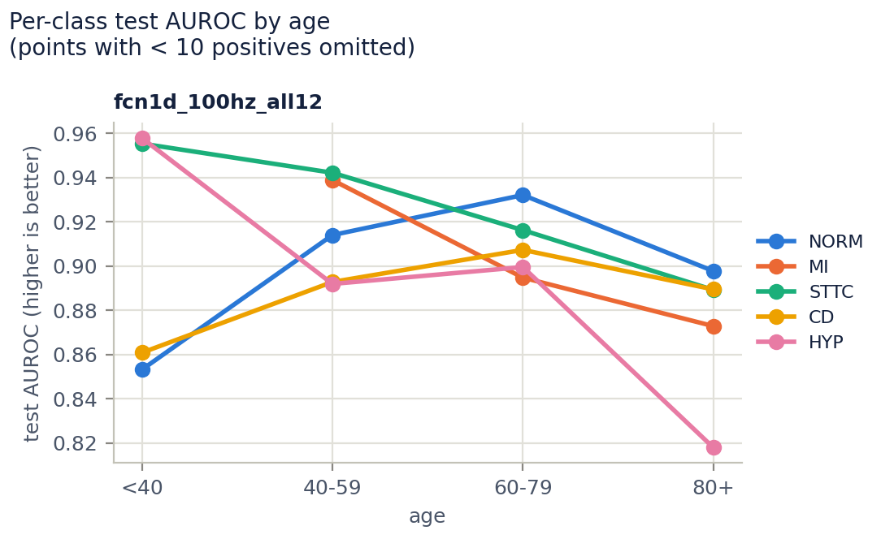

# ECG Classification

Multi-label classification of 12-lead ECGs from the [PTB-XL](https://physionet.org/content/ptb-xl/) dataset [[1, 2]](#references) into the 5 diagnostic superclasses:

| Code | Meaning |
|:----:|:--------|
| **NORM** | Normal ECG |
| **MI**   | Myocardial infarction |
| **STTC** | ST/T change |
| **CD**   | Conduction disturbance |
| **HYP**  | Hypertrophy |

Several classes can be true at once, so every model has 5 sigmoid outputs trained with binary cross-entropy.

---

## Repository structure

```text
.
├── src/
│   ├── config.py                          paths, classes, lead sets, official split, STANDARD training protocol
│   ├── data/
│   │   ├── preprocess.py                  build the signal cache (once per sampling rate)
│   │   ├── dataset.py                     label aggregation, lead selection, split, standardization
│   │   └── augment.py                     noise / baseline wander / scaling / time shift (for E3)
│   ├── models/
│   │   ├── __init__.py                    model registry
│   │   ├── fcn1d.py                       FCN of Wang et al. (B0 baseline)
│   │   └── resnet1d.py                    ResNet1D-18/-34
│   ├── training/
│   │   └── train.py                       training loop, logging, checkpointing (+ test evaluation at the end)
│   ├── evaluation/
│   │   ├── age_analysis.py                test metrics per age group and per sex (error analysis)
│   │   ├── evaluate.py                    (re-)evaluate runs: val/test metrics, val-tuned thresholds, bootstrap CIs
│   │   ├── metrics.py                     AUROC, AUPRC, F1 (macro + per class)
│   │   └── summarize.py                   collect runs of an experiment into tables (mean ± std over seeds)
│   ├── visualize/
│   │   ├── exploratory_data_analysis.py   EDA figures + summary numbers
│   │   └── plot_runs.py                   learning curves and per-class plots for any experiment
│   └── experiments/
│       ├── b0_baseline.py                 B0: FCN baseline (benchmark reproduction)
│       └── e1_depth.py                    E1: ResNet1D-18 vs ResNet1D-34
├── runs/<exp>/<run>/                      one folder per training run (weights not tracked)
├── eda/                                   EDA outputs
├── documentation/                         initial report (PDF) and presentation (PPTX)
└── data/                                  PTB-XL raw + processed (not tracked, see below)
```

> Each file that can be run has its usage in its docstring and `--help`.

---

## Setup

**Python 3.12.** PyTorch is installed separately because it needs the CUDA build (cu128 is required for RTX 50xx GPUs; pick another index for older GPUs or CPU).

```bash
python -m venv .venv
.venv\Scripts\activate          # Windows
# source .venv/bin/activate     # Linux / macOS
pip install torch==2.11.0 --index-url https://download.pytorch.org/whl/cu128
pip install -r requirements.txt
```

### Data

Download PTB-XL **v1.0.1** [[2]](#references) from [PhysioNet](https://physionet.org/content/ptb-xl/1.0.1/) [[3]](#references) (21,837 records, the version used by the benchmark of Strodthoff et al. [[4]](#references); v1.0.3 removed duplicates and has 21,799) and extract it so that the files sit under `data/ptb-xl/` (e.g. `data/ptb-xl/ptbxl_database.csv`). Then build the cache:

```bash
python -m src.data.preprocess              # 100 Hz, ~1 GB, ~30 s
python -m src.data.preprocess --fs 500     # 500 Hz, ~5.2 GB (only needed for E5)
```

The cache stores **all** records with **all** 12 leads as raw mV (`data/processed/ptbxl_<fs>hz.npy`, shape `(21837, 12, fs*10)`, plus `labels.csv`). Everything that changes between experiments is applied at load time, so the same cache serves every experiment:

| Option | Values | Used by |
|:-------|:-------|:-------:|
| `--fs` | `100`, `500` | E5 |
| `--leads` | `all12`, `limb6`, `precordial6`, `lead1`, `lead2`, or any list like `I,II,V2` | E4 |
| `--augment` | `none` or any of `noise,wander,scale,shift` | E3 |
| `--model` | `fcn1d`, `resnet1d18`, `resnet1d34` (add new ones in `src/models/__init__.py`) | B0, E1, E2 |

**Labels:** every diagnostic SCP statement is mapped to its superclass regardless of likelihood (as in the PhysioNet example and the Strodthoff et al. benchmark [[4]](#references)). The 407 records with no superclass label are dropped. Signals are z-scored per lead with mean/std from the training folds only.

### Exploratory data analysis

```bash
python -m src.visualize.exploratory_data_analysis
```

This writes the figures to `eda/figures/` and `eda/figures/slides/`, and the summary statistics to `eda/eda_summary.json`.

---

## Standard training protocol

All experiments use these settings (defined once in `src/config.py`, `STANDARD`) and change only the factor they study.

| Setting | Value |
|:--------|:------|
| **Split** | official `strat_fold`: train 1–8 (17,111 records), val 9 (2,156), test 10 (2,163) |
| **Input** | 100 Hz, 12 leads, full 10 s, per-lead standardization |
| **Loss** | `BCEWithLogits`, 5 outputs |
| **Optimizer** | AdamW [[5]](#references), weight decay 0.01, batch size 128 |
| **Schedule** | one-cycle [[6]](#references), peak LR 1e-3, 30% warm-up, cosine decay |
| **Epochs** | **50, fixed** (no early stopping) |
| **Checkpoint** | epoch with the best **validation macro AUROC** |
| **Seeds** | 0, 1, 2; results reported as mean ± std |
| **Test metrics** | macro + per-class AUROC and AUPRC; macro + per-class F1 at 0.5 and at per-class thresholds tuned on validation; 95% percentile bootstrap CIs [[7]](#references) (1,000 resamples) |
| **Precision** | bf16 autocast on GPU; runs are deterministic for a given seed and GPU |

---

## Running experiments

```bash
python -m src.training.train --exp scratch --model resnet1d18 --seeds 0   # one run
python -m src.training.train --exp e4_leads --model resnet1d18 --leads limb6 --seeds 0 1 2
python -m src.evaluation.evaluate --exp e1_depth     # re-evaluate + summarize
python -m src.evaluation.summarize --exp e1_depth
python -m src.visualize.plot_runs --exp e1_depth
```

Each run writes to `runs/<exp>/<model>_<fs>hz_<leads>[_aug-…]_s<seed>/`:

| File | Content |
|:-----|:--------|
| `config.json` | every setting, parameter count, dataset sizes, git commit, best epoch, timing |
| `history.csv` | one row per epoch: `lr`, `train_loss`, `val_loss`, and `{train,val}_{macro_auc,macro_ap,macro_f1}`, `{train,val}_{auc,ap,f1}_<CLASS>` |
| `metrics.json` | val and test metrics of the best checkpoint, tuned thresholds, CIs |
| `predictions.npz` | val/test `ecg_id`, labels and probabilities (for ROC/PR curves) |
| `norm_stats.npz` | per-lead mean/std used for standardization |
| `best.pt`, `last.pt` | weights (not tracked by git) |

Per experiment: `runs/<exp>/runs.csv`, `summary.csv` / `summary.md` (mean ± std per variant) and `figures/`.

---

## Experiments

### B0: Can we reproduce a benchmark? FCN baseline

```bash
python -m src.experiments.b0_baseline                 # FCN, 3 seeds, standard protocol
python -m src.evaluation.age_analysis --exp b0_baseline
```

The baseline is the fully convolutional network (FCN) of Wang et al. [[10]](#references): three blocks of Conv1d + BatchNorm + ReLU with 128/256/128 filters and kernel sizes 8/5/3 (stride 1, "same" padding, no downsampling), global average pooling and a linear head (**0.28M** parameters). The same architecture is `fcn_wang` in the benchmark of Strodthoff et al. [[4]](#references), which reports a macro AUROC of **0.925** on the superclass task, so B0 is compared with a published number for the same model.

`age_analysis` recomputes the test metrics of every run separately per age group (<40, 40–59, 60–79, 80+; the PTB-XL placeholder age 300 is mapped to 90+) and per sex, with group sizes, class prevalence per group and 95% bootstrap CIs. It only reads `predictions.npz`, so it also works on any earlier experiment (e.g. `--exp e1_depth`). Outputs: `runs/<exp>/subgroups/` (`age_summary.md`, `sex_summary.md`, CSVs, `figures/`).

#### Results

*Test set (fold 10), mean ± std over 3 seeds:*

| Model | Params | Macro AUROC | Macro AUPRC | Macro F1 @0.5 | Macro F1 @tuned | NORM | MI | STTC | CD | HYP |
|:------|-------:|------------:|------------:|--------------:|----------------:|-----:|---:|-----:|---:|----:|
| **FCN (B0)** | 0.28M | **0.9192 ± 0.0013** | 0.8065 ± 0.0012 | 0.7231 ± 0.0055 | 0.7368 ± 0.0035 | 0.9395 | 0.9232 | 0.9322 | 0.9063 | 0.8947 |
| `fcn_wang`, benchmark [[4]](#references) | – | 0.925 | – | – | – | – | – | – | – | – |

- **Benchmark approximately reproduced.** The macro AUROC (0.919) is 0.006 below the 0.925 reported for the same architecture by Strodthoff et al. [[4]](#references). The same difference in training procedure as discussed for E1 (random 2.5 s crops in the benchmark vs full 10 s recordings here) is a plausible explanation. The three seeds give 0.9184, 0.9185 and 0.9206, and re-running a seed reproduces its result exactly.

- **No overfitting.** The best validation epoch lies between 32 and 37 and the validation loss stays at approximately 0.29 until the end of training, while the training loss decreases to 0.19. With 0.28M parameters the network cannot memorize the training set, unlike the ResNets of E1.

- **The small FCN outperforms both ResNets** of E1 (0.919 vs 0.913) with 22–42 times fewer parameters, consistently over all seeds. Together with the early overfitting of the ResNets, this indicates that performance on PTB-XL is limited by generalization rather than by model capacity.

- **CD and HYP remain the weakest classes**, as for the ResNets.

#### Performance by age and sex

*Test set (fold 10), macro AUROC, mean ± std over 3 seeds, 95% bootstrap CI (B0); 15 test records without age are left out of the age groups:*

| Age | n | % NORM | FCN (B0) | 95% CI | ResNet1D-18 | ResNet1D-34 |
|:----|--:|-------:|---------:|:------:|------------:|------------:|
| <40 | 284 | 83.1 | 0.9225 ± 0.0054 | [0.890, 0.949] | 0.8988 | 0.9033 |
| 40–59 | 642 | 60.4 | 0.9159 ± 0.0019 | [0.899, 0.931] | 0.9076 | 0.9070 |
| 60–79 | 916 | 34.8 | 0.9099 ± 0.0011 | [0.899, 0.921] | 0.9031 | 0.9042 |
| 80+ | 306 | 6.9 | **0.8734 ± 0.0010** | [0.848, 0.895] | 0.8679 | 0.8652 |
| all | 2163 | 44.6 | 0.9192 ± 0.0013 | [0.912, 0.926] | 0.9127 | 0.9131 |

- **Performance drops for patients aged 80+** for all three models; for B0 the 95% CI of this group does not overlap with that of the whole test set. In this group only 6.9% of the records are normal and most carry several superclasses at once (MI 46.7%, STTC 42.8%, CD 42.2%), so co-occurring pathologies have to be separated. HYP is affected most (AUROC 0.818 for B0 at 80+).
- **Results for patients under 40 are uncertain:** the group contains few abnormal records (e.g. 7 MI cases), which gives a wide CI.
- **By sex**, B0 reaches 0.931 [0.921, 0.939] for men and 0.907 [0.895, 0.919] for women, with the largest gaps for MI (0.938 vs 0.905) and STTC (0.944 vs 0.919); the ResNets show the same direction (0.918 vs 0.907 for ResNet1D-18).
- Full tables: `runs/b0_baseline/subgroups/` and `runs/e1_depth/subgroups/`.

<p align="center">
  
</p>
<p align="center">
  
  
</p>

### E1: Does depth help? ResNet1D-18 vs ResNet1D-34

```bash
python -m src.experiments.e1_depth
```

Both networks are the ResNet-18/34 layout [[8]](#references) carried over to 1D (stem conv k=7 stride 2 + max-pool, four stages of basic blocks with 64/128/256/512 channels and kernel size 5, global average pooling, linear head). The last batch-norm of every residual branch is zero-initialized [[9]](#references), so each block starts as the identity and the deeper network trains as easily as the shallow one. They differ only in blocks per stage: `[2,2,2,2]` (**6.3M** parameters) vs `[3,4,6,3]` (**11.9M** parameters).

#### Results

*Test set (fold 10), mean ± std over 3 seeds:*

| Model | Params | Macro AUROC | Macro AUPRC | Macro F1 @0.5 | Macro F1 @tuned | NORM | MI | STTC | CD | HYP |
|:------|-------:|------------:|------------:|--------------:|----------------:|-----:|---:|-----:|---:|----:|
| **ResNet1D-18** | 6.3M | **0.9127 ± 0.0017** | 0.7978 ± 0.0036 | 0.7049 ± 0.0160 | 0.7255 ± 0.0066 | 0.9356 | 0.9049 | 0.9283 | 0.8995 | 0.8951 |
| **ResNet1D-34** | 11.9M | **0.9131 ± 0.0017** | 0.7973 ± 0.0040 | 0.6926 ± 0.0098 | 0.7239 ± 0.0053 | 0.9368 | 0.9044 | 0.9264 | 0.9036 | 0.8942 |

- **No measurable difference in performance.** The difference in macro AUROC between the two models (0.0004) is an order of magnitude smaller than the standard deviation across seeds (0.0017) and lies well within the 95% bootstrap confidence interval of each individual run (approximately ± 0.0075). The per-class AUROC values overlap for all five superclasses; the largest deviations, a slight increase for CD (+0.004) and a slight decrease for STTC (−0.002) with ResNet1D-34, are within the range of random variation.

- **Increased computational cost without performance benefit.** ResNet1D-34 requires 1.9 times as many parameters and 1.8 times the training time of ResNet1D-18 while achieving equivalent performance. ResNet1D-18 is therefore adopted as the convolutional reference model for the subsequent experiments.

- **Early onset of overfitting in both models.** Validation macro AUROC reaches its maximum between epochs 8 and 11. Beyond this point, the training loss decreases to approximately 0.0005 while the validation loss increases from 0.31 to 0.84, indicating that both networks memorize the training set at a comparable rate. This suggests that generalization is limited by insufficient regularization and training data rather than by model capacity, which motivates the augmentation study in E3.

- **Discrepancy with the published benchmark.** The macro AUROC obtained here (0.913) is below the 0.930 reported for `resnet1d_wang`, the 1D ResNet of Wang et al. [[10]](#references), in the PTB-XL benchmark of Strodthoff et al. [[4]](#references). A plausible explanation is a difference in training procedure: the benchmark models are trained on randomly cropped 2.5 s segments and evaluated by aggregating predictions over sliding windows, which acts as a strong form of data augmentation, whereas the present models are trained on the full 10 s recordings without augmentation.

<p align="center">
  
</p>

---

## References

1. Wagner, P., Strodthoff, N., Bousseljot, R.-D., Kreiseler, D., Lunze, F. I., Samek, W., and Schaeffter, T. (2020). PTB-XL, a large publicly available electrocardiography dataset. *Scientific Data*, 7, 154. <https://doi.org/10.1038/s41597-020-0495-6>
2. Wagner, P., Strodthoff, N., Bousseljot, R., Samek, W., and Schaeffter, T. (2020). PTB-XL, a large publicly available electrocardiography dataset (version 1.0.1). *PhysioNet*. <https://physionet.org/content/ptb-xl/1.0.1/>
3. Pollard, T., Moody, B. E., Lehman, L., Gow, B., Fernandes, C., Xie, C., Johnson, A., Mark, R. G., and Heldt, T. (2026). PhysioNet as a global platform for biomedical research. *Nature Health*. <https://doi.org/10.1038/s44360-026-00096-z>
4. Strodthoff, N., Wagner, P., Schaeffter, T., and Samek, W. (2021). Deep learning for ECG analysis: Benchmarks and insights from PTB-XL. *IEEE Journal of Biomedical and Health Informatics*, 25(5), 1519–1528. <https://doi.org/10.1109/JBHI.2020.3022989>
5. Loshchilov, I., and Hutter, F. (2019). Decoupled weight decay regularization. *International Conference on Learning Representations (ICLR)*. <https://arxiv.org/abs/1711.05101>
6. Smith, L. N., and Topin, N. (2019). Super-convergence: Very fast training of neural networks using large learning rates. *Artificial Intelligence and Machine Learning for Multi-Domain Operations Applications*, Proc. SPIE 11006. <https://arxiv.org/abs/1708.07120>
7. Efron, B., and Tibshirani, R. J. (1993). *An Introduction to the Bootstrap*. Chapman & Hall/CRC.
8. He, K., Zhang, X., Ren, S., and Sun, J. (2016). Deep residual learning for image recognition. *IEEE Conference on Computer Vision and Pattern Recognition (CVPR)*, 770–778. <https://doi.org/10.1109/CVPR.2016.90>
9. Goyal, P., Dollár, P., Girshick, R., Noordhuis, P., Wesolowski, L., Kyrola, A., Tulloch, A., Jia, Y., and He, K. (2017). Accurate, large minibatch SGD: Training ImageNet in 1 hour. <https://arxiv.org/abs/1706.02677>
10. Wang, Z., Yan, W., and Oates, T. (2017). Time series classification from scratch with deep neural networks: A strong baseline. *International Joint Conference on Neural Networks (IJCNN)*, 1578–1585. <https://arxiv.org/abs/1611.06455>
